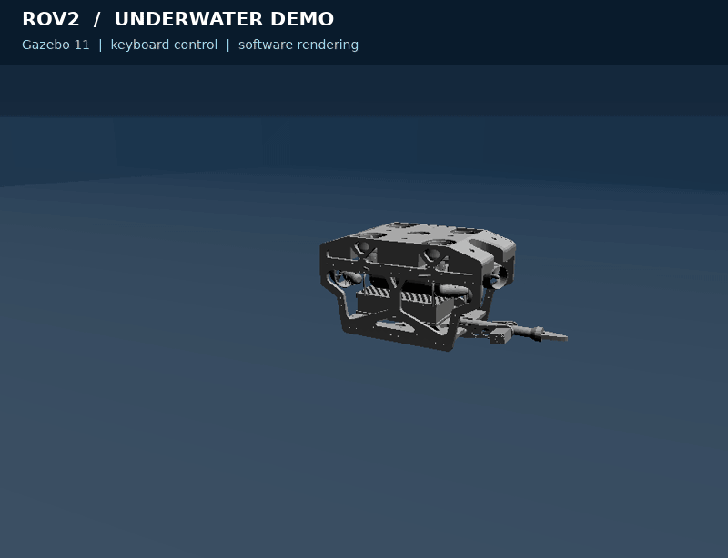
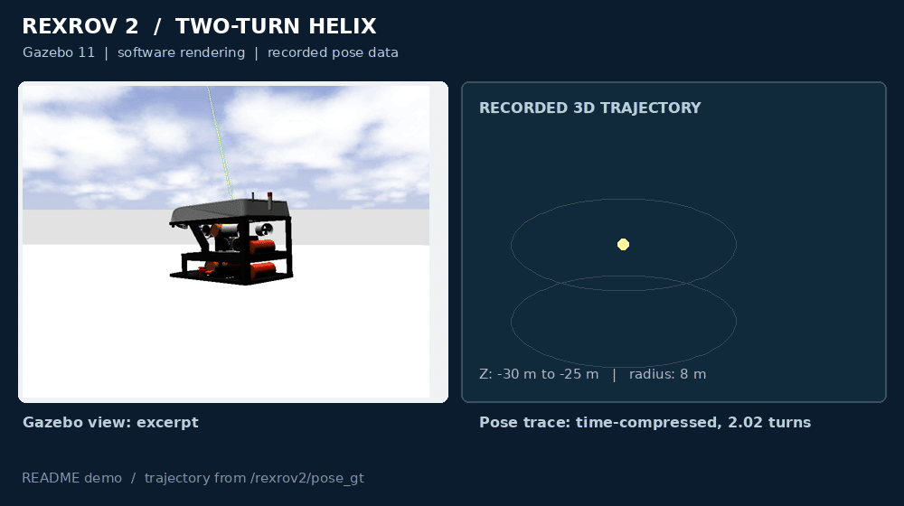
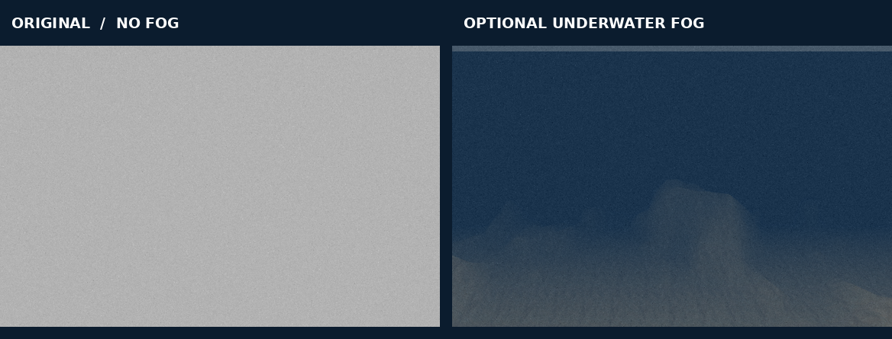
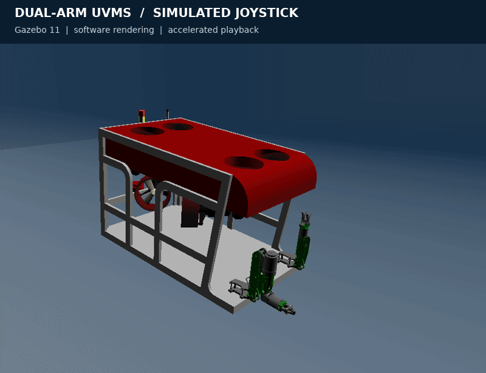

## ROV2_ws — 水下航行器仿真工作空间

基于 ROS Noetic 和 Gazebo 的水下航行器仿真与控制平台，包含自定义 ROV、RexROV 2、推进器控制、传感器和水下机械臂。



演示模型采用 X 前、Y 左、Z 上坐标，质量、惯量、阻尼与浮力使用估算值；机械臂和 CAD 视觉关节在该场景中固定。

## 目录

- [Docker 部署与启动](#docker-部署与启动推荐)
- [其他仿真场景](#其他仿真场景)
- [从源码构建](#从源码构建)
- [已完成的修复与仿真结果](#已完成的修复与仿真结果)
- [项目结构与主要文件](#项目结构与主要文件)
- [上游项目与许可证](#上游项目与许可证)

## Docker 部署与启动（推荐）

已发布镜像基于 ROS Noetic / Gazebo 11，工作空间已在镜像内编译，无需再安装依赖或编译源码。镜像版本对应源码提交 已发布镜像基于 ROS Noetic / Gazebo 11，工作空间已在镜像内编译，无需再安装依赖或编译源码。镜像版本对应源码提交 `0e87293`；后续分支新增功能需使用包含相关修改的源码构建。镜像包：；后续分支新增功能需使用包含相关修改的源码构建。镜像包：[`ghcr.io/yuetsai2007/rov2_ws:fix-0e87293`](https://github.com/YueTsai2007/ROV2_ws/pkgs/container/rov2_ws)。。

### 1. 准备 Docker Desktop 和 WSLg

在 Windows 的 Docker Desktop 设置中启用 WSL 2 引擎，并为 Ubuntu 发行版启用 WSL Integration。然后从 在 Windows 的 Docker Desktop 设置中启用 WSL 2 引擎，并为 Ubuntu 发行版启用 WSL Integration。然后从 **Ubuntu WSL 终端**执行下面的命令；不要在普通 Windows PowerShell 中运行 WSLg 图形启动命令。Ubuntu 终端应能运行 执行下面的命令；不要在普通 Windows PowerShell 中运行 WSLg 图形启动命令。Ubuntu 终端应能运行 `docker version`，并且 ，并且 `/mnt/wslg` 存在。 存在。

```bash
docker version
ls /mnt/wslg
```

### 2. 拉取 Fix 分支镜像

```bash
docker pull ghcr.io/yuetsai2007/rov2_ws:fix-0e87293
```

### 3. 创建带 NVIDIA GPU 和 WSLg 图形转发的容器

在 Ubuntu WSL 终端执行。`--gpus all` 请求 Docker 将 NVIDIA GPU 暴露给容器；`/mnt/wslg` 和相关环境变量用于把 WSLg 的 X11/Wayland 图形会话转发到容器。

```bash
docker run -it --name rov2-fix --gpus all \
  -e DISPLAY="$DISPLAY" \
  -e WAYLAND_DISPLAY="$WAYLAND_DISPLAY" \
  -e XDG_RUNTIME_DIR=/mnt/wslg/runtime-dir \
  -e PULSE_SERVER="$PULSE_SERVER" \
  -e NVIDIA_DRIVER_CAPABILITIES=all \
  -v /mnt/wslg:/mnt/wslg \
  -v /tmp/.X11-unix:/tmp/.X11-unix:rw \
  ghcr.io/yuetsai2007/rov2_ws:fix-0e87293 bash
```

这会进入容器 shell。若提示容器名已存在，先使用 `docker ps -a` 检查该容器所属镜像与状态，再决定继续使用它或为新容器指定其他名称；已有同名容器不一定基于本教程的发布镜像。

### 4. 在容器内启动 Gazebo 仿真

容器 shell 中加载镜像内已编译的 ROS 和工作空间：

```bash
source /opt/ros/noetic/setup.bash
source /opt/rov2-release/devel/setup.bash
```

启动带 Gazebo GUI、PID 控制器并立即运行的低推力演示：

```bash
roslaunch underwater_robot demo.launch gui:=true paused:=false start_controller:=true
```

如果只需无界面仿真，将 `gui:=true` 改成 `gui:=false`。若要先检查场景再运行，可用 `paused:=true`，之后在另一终端调用 `/gazebo/unpause_physics`。

### 5. 在第二个终端遥控

保持 Gazebo 终端运行，在另一个 Ubuntu WSL 终端进入同一个容器：

```bash
docker exec -it rov2-fix bash
source /opt/ros/noetic/setup.bash
source /opt/rov2-release/devel/setup.bash
roslaunch underwater_robot demo_keyboard.launch
```

键盘终端需要保持焦点：W/S 前后、A/D 左右、R/F 上下、Q/E 转向；空格清除速度参考，Ctrl+C 退出键盘控制。守护节点使用墙钟检查 0.5 秒输出超时，默认每路推力上限为 8 N。键盘无输入约 0.2 秒后会发零速度。零速度是位置保持参考，不等同于冻结物理仿真；暂停/恢复 Gazebo 使用：

```bash
rosservice call /gazebo/pause_physics
rosservice call /gazebo/unpause_physics
```

### 6. 在容器内启动 RViz

另开一个 WSL 终端并再次进入容器、加载环境后运行：

```bash
docker exec -it rov2-fix bash
source /opt/ros/noetic/setup.bash
source /opt/rov2-release/devel/setup.bash
rviz -d "$(rospack find underwater_robot)/config/standard_ros.rviz"
```

本项目使用 ROS 1 的 **RViz**，不是 RViz2。当前配置以 `world` 为 Fixed Frame，机器人视角跟随 `underwater_robot/base_link`。运行中的演示已经发布机器人描述和 TF，不要再同时启动独立的 `display.launch`，否则会引入重复的模型描述或 TF。

### 停止和再次进入

仿真及键盘节点分别按 Ctrl+C 后，在容器 shell 输入 `exit`。容器停止后可从 WSL 终端重新进入：

```bash
docker start rov2-fix
docker exec -it rov2-fix bash
```

若只想结束仿真而保留容器，关闭运行 `roslaunch` 的终端即可；要停止容器则运行 `docker stop rov2-fix`。

## 其他仿真场景

以下场景在已加载 ROS 和工作空间环境的终端中运行；切换前请停止前一个场景，避免重复启动 Gazebo 和 ROS master。

### 1. 自定义 ROV：基础 Gazebo 测试

此示例使用简化几何模型，适合确认 Gazebo 和机器人模型能加载；它不是带推进器和 PID 的完整水下场景。

**终端 1**：

```bash
# 无图形环境；有可用桌面时改为 gui:=true
roslaunch underwater_robot simple_gazebo_test.launch gui:=false
```

等待日志出现 `Successfully spawned entity`。保持终端 1 运行，在已加载环境的**终端 2**检查：

```bash
rosnode list
rosservice call /gazebo/get_model_properties "model_name: 'underwater_robot'"
```

返回 `success: True` 表示模型已加载。按终端 1 中的 `Ctrl+C` 停止场景，待进程退出后再运行下一种场景。

### 2. 自定义 ROV：水下场景与控制器

**终端 1：启动场景和机器人。** 默认暂停，且不会启动 PID。无图形环境使用下面的命令；有图形桌面时可改为 `gui:=true`。

```bash
roslaunch underwater_robot bringup.launch gui:=false paused:=true
```

等待模型生成成功，然后在**终端 2**检查模型和接口：

```bash
rosservice call /gazebo/get_model_properties "model_name: 'underwater_robot'"
rostopic list | grep '^/underwater_robot/'
rostopic info /underwater_robot/pose_gt
rostopic info /underwater_robot/thrusters/0/input
rostopic info /underwater_robot/joint_states
```

模型查询应返回 `success: True`；话题信息可用于检查发布者和订阅者。仿真暂停时，传感器消息和 `/clock` 可能不更新，`rostopic echo` 可能一直等待，这不代表话题不存在。

在终端 2 恢复或再次暂停仿真：

```bash
rosservice call /gazebo/unpause_physics '{}'
rosservice call /gazebo/pause_physics '{}'
```

恢复后可用 `rostopic echo -n 1 /underwater_robot/pose_gt` 查看一条位姿消息。在另一个已加载环境的终端启动 PID 和推进器分配器：

```bash
roslaunch underwater_robot start_uuv_pid_controller.launch
```

控制器依赖位姿和 TF。原始模型的质量、浮力与推进参数使用估算值，推进矩阵秩为 5。低推力遥控演示请使用 `demo.launch`。

可选的 RViz 模型查看命令如下，需要图形桌面：

```bash
roslaunch underwater_robot display.launch
```

`display.launch` 是独立的机器人描述可视化流程；请先停止当前仿真，再使用它，避免重复发布模型描述和 TF。结束时在启动控制器和场景的终端分别按 `Ctrl+C`。

### 3. RexROV 2：水下场景和螺旋轨迹



左侧为 Gazebo 跟随视角，右侧为根据 `/rexrov2/pose_gt` 绘制的轨迹。[位姿数据](docs/media/rexrov-helix-poses.csv)使用仿真时间（秒）和世界坐标（米）。

先停止上一场景。**终端 1**启动海洋环境、RexROV 2、推进器分配器和 PID：

```bash
# 无图形环境；有桌面时可使用 gui:=true
roslaunch rexrov2_gazebo start_demo_pid_controller.launch gui:=false
```

源码构建的当前分支还提供可选的水下雾效，减少远处海底和背景发白：

```bash
roslaunch rexrov2_gazebo start_demo_pid_controller.launch gui:=true underwater_visual:=true
```

不指定该参数（或设置为 `false`）时沿用原始场景。雾效是整个场景的渲染效果，也会影响水面以上和仿真相机，不改变水动力；它不会把水体变成真实的体积水。此选项需要使用包含本次修改的源码工作空间，顶部已有的 `fix-0e87293` 发布镜像不包含它，需重新构建工作空间或镜像后使用。



上图展示原场景与水下雾效的相机画面对比。

等待模型生成、`ThrusterManager: ready` 和 `PID controller ready!` 等日志。新开并配置好环境的**终端 2**检查：

```bash
rosnode list | grep rexrov2
rostopic list | grep '^/rexrov2/'
rostopic echo -n 1 /rexrov2/pose_gt
```

确认控制器就绪后，在终端 2 发送螺旋轨迹：

```bash
roslaunch uuv_control_utils start_helical_trajectory.launch \
  uuv_name:=rexrov2 n_turns:=2 radius:=8
```

命令退出后，检查终端 1 的轨迹生成日志；也可查看轨迹话题：

```bash
rostopic info /rexrov2/dp_controller/trajectory
rostopic echo -n 1 /rexrov2/dp_controller/trajectory/header
```

两圈轨迹跟踪的验证记录见 [控制链修复与验证](docs/CONTROL_DEMO_FIX.md)。终端 1 按 `Ctrl+C` 结束整个场景。

### 4. 双机械臂 UVMS：场景、模型和协同控制



通过 `/rexrov/joy` 控制载体与两只机械臂。

先停止上一场景，并在每个新终端加载环境。协同遥控需要安装 `tf_conversions` 并连接摇杆；容器使用摇杆时还需在**创建容器时**将设备映射进去，例如 Docker 的 `--device=/dev/input/js0:/dev/input/js0`。请根据实际设备调整编号。

**终端 1：启动海底场景。**

```bash
roslaunch uuv_gazebo_worlds subsea_bop_panel.launch gui:=true
```

等待 Gazebo 启动并提供 `/gazebo/spawn_urdf_model` 服务。在**终端 2**确认服务并生成模型：

```bash
rosservice list | grep /gazebo/spawn_urdf_model
roslaunch uuv_descriptions upload_rexrov_oberon_arms.launch \
  x:=0 y:=0 z:=-40 namespace:=rexrov
```

等待 `Successfully spawned entity`，保持终端 1 和终端 2 运行。**终端 3：启动协同控制。**

```bash
roslaunch oberon7_control uuv_oberon7_cooperate_teleop.launch \
  uuv_name:=rexrov model_name:=rexrov joy_id:=0
```

**终端 4** 为另一只机械臂启动关节控制。

```bash
roslaunch oberon4_control joint_control.launch uuv_name:=rexrov
```

两个机械臂和载体共用 `/rexrov/joy`。已用仿真的 `Joy` 消息验证载体和双臂同时运动，并抽测 Oberon 7 夹爪。暂停仿真时控制器可能等待 TF。结束时依次关闭终端 4、3、2、1。

更多轨迹、扰动和推进器命令可参考 [docs/shuoming.txt](docs/shuoming.txt)；启动参数以本 README 和对应 launch 文件为准。

---

## 从源码构建

以下步骤适用于源码开发；已发布镜像的工作空间已编译，可直接按前文启动。

### 依赖环境

| 组件 | 版本要求 |
|------|---------|
| **ROS** | Noetic（推荐） / Melodic |
| **Gazebo** | 9+ |
| **Python** | 3.6+ |
| **OS** | Ubuntu 20.04（WSL2 可用） |
| **编译工具** | catkin, C++14 编译器 |

### 关键 ROS 依赖

```bash
sudo apt install ros-noetic-joy \
  ros-noetic-robot-state-publisher \
  ros-noetic-joint-state-publisher-gui \
  ros-noetic-rviz \
  ros-noetic-gazebo-ros-pkgs \
  ros-noetic-gazebo-ros-control \
  ros-noetic-ros-control \
  ros-noetic-ros-controllers \
  ros-noetic-tf2-ros \
  ros-noetic-tf-conversions \
  ros-noetic-xacro \
  python3-catkin-tools
```

---

### 准备环境和构建

以下步骤以 **Ubuntu 20.04、ROS Noetic、Gazebo 11** 为例。每个终端都需要加载 ROS 和工作空间环境。

#### 获取源码

使用本 README 顶部的已发布镜像时，无需执行本节。以下步骤用于已有源码工作区的本机 Ubuntu，或已挂载源码且预装 ROS Noetic / Gazebo 11 依赖的开发容器；假设工作空间路径为 `/ws`，请按实际路径替换。仅使用基础 ROS 镜像并不保证已安装 Gazebo 和本项目全部依赖。

**本机 Ubuntu** 可跳过 Docker 步骤，将下文 `/ws` 替换为本机仓库路径，例如 `~/ROV2_ws`。如果尚未获取代码：

```bash
git clone -b fix/underwater-robot-round1 https://github.com/YueTsai2007/ROV2_ws.git ~/ROV2_ws
```

#### 安装依赖并编译

在容器内或本机工作空间执行。首次使用 `rosdep` 时，请先按 ROS 官方安装说明完成初始化和更新。

```bash
source /opt/ros/noetic/setup.bash
cd /ws
rosdep install --from-paths src --ignore-src -r -y
catkin_make -j2
source /ws/devel/setup.bash
```

如果依赖已经安装，可跳过 `rosdep install`。编译完成后验证包可以找到：

```bash
rospack find underwater_robot
rospack find rexrov2_gazebo
```

**每次新开终端**，都要重新进入同一个容器并加载环境：

```bash
# 宿主机：使用相同容器名再打开一个 shell
docker exec -it <容器名> bash

# 容器内：每个新终端都执行
source /opt/ros/noetic/setup.bash
source /ws/devel/setup.bash
cd /ws
```

本机 Ubuntu 用户只需在每个新终端执行上述两条 `source` 和 `cd`，并替换工作空间路径。

---

## 已完成的修复与仿真结果

已修复机械臂外部命令转发、模型生成脚本兼容性、传感器插件初始化以及相关启动配置。

- ROS Noetic / Gazebo 11 容器内全工作区构建通过。传感器改动重新编译后，Python 回归 19 项全部通过。
- 前进、左移、上升和转向已通过低推力仿真测试。持续水流为 0.20 m/s 时，稳态位置误差约 1.6 mm，撤流恢复后约 3.8 mm，单路峰值推力约 3.34 N。
- RexROV 2 完成两圈螺旋轨迹，位置 RMSE 约 0.187 m。模拟摇杆驱动载体和双臂联动。
- Gazebo 演示机器人初始位于世界坐标 `(0, 0, -3)` m。
- 自定义机械臂的 ±1 rad 位置限位已通过仿真测试。

详细修改见 [修复记录](docs/CONTROL_DEMO_FIX.md)。原始模型启动入口用于研发对照，低推力遥控演示请使用 `demo.launch`。

---

## 项目结构与主要文件

### 目录结构

```
ROV2_ws/
├── README.md                 # 项目说明
├── .catkin_workspace          # catkin 工作空间标记
├── scripts/                   # 辅助脚本
│   ├── debug_simulation.sh    #   仿真环境调试
│   └── fixed_ned_tf.sh        #   NED 坐标系 TF 修复
├── docs/                      # 文档与参考资料
│   ├── shuoming.txt           #   详细使用说明（控制命令、轨迹规划、扰动、机械臂）
│   ├── velocity.txt           #   速度命令 / 推进器测试备忘
│   ├── frames.gv / frames.pdf #   TF 树可视化
│   ├── underwater_robot.csv   #   机器人数据
│   └── upstream/              #   上游项目原始文档（AGDR_UVMS）
└── src/                       # ROS 包（所有包平级）
    ├── underwater_robot/      # ★ 自定义 ROV 包
    ├── rexrov2/               # RexROV 2 航行器
    ├── joy_teleop/            # 摇杆遥控
    ├── uuv_simulator/         # UUV 模拟器核心（13 个子包）
    ├── uuv_manipulators/      # 水下机械臂（Oberon4/7）
    ├── kdl_parser/            # KDL 运动学解析器 (C++)
    ├── kdl_parser_py/         # KDL Python 绑定
    ├── uuv_simulation_wrapper/# 仿真封装器
    ├── uuv_with_hands_descriptions/
    ├── rexrov_dual_oberon_description/
    ├── oberon4_with_hand_description/
    ├── oberon7_with_hand_description/
    └── teleop_tools_msgs/     # 遥控消息定义
```

---

### 自定义 ROV 说明

#### 配置

| 文件 | 说明 |
|------|------|
| `config/thruster_manager.yaml` | 6 推进器配置（位置、方向、最大推力 200N） |
| `config/TAM.yaml` | 推力分配矩阵（6×6） |
| `config/joints.yaml` | 关节状态控制器 |

#### URDF 模型

| 文件 | 用途 |
|------|------|
| `urdf/underwater_robot.urdf` | ★ 核心 URDF 基础模型 |
| `urdf/underwater_robot_complete.xacro` | 完整版（含执行器） |
| `urdf/underwater_robot_uuv2.xacro` | UUV 框架兼容版（当前使用） |
| `urdf/underwater_robot_simple_geometry.urdf` | 简化几何版（快速测试） |
| `urdf/underwater_robot_clean.urdf` | 历史 launch 内容，不能作为 URDF 加载 |
| `urdf/underwater_robot_simple_hydro.xacro` | 简化流体动力学版 |
| `urdf/archive/` | 历史/未使用版本 |

#### 启动文件

| 文件 | 用途 |
|------|------|
| `launch/simple_gazebo_test.launch` | 最简 Gazebo 测试 |
| `launch/start_uuv_pid_controller.launch` | PID 控制器及推进器分配器（需先启动场景和机器人） |
| `launch/final_underwater_sim.launch` | 最终水下仿真 |
| `launch/headless_underwater.launch` | 无头演示模型，默认暂停且未启动控制器 |
| `launch/underwater_robot_control.launch` | 为已启动的演示模型启动 PID，可选 `joy_on:=true` |
| `launch/arm_control.launch` | 机械臂独立控制 |
| `launch/underwater_ned_compatible.launch` | NED 坐标系兼容 |

---

## 上游项目与许可证

本项目集成了 [AGDR_UVMS](https://github.com/TUSZ-AGDR/agdr_uvms)，是 [UUV Simulator](https://github.com/uuvsimulator/uuv_simulator) 的 ROS Noetic 兼容分支。

- 上游许可证：[docs/upstream/LICENSE.txt](docs/upstream/LICENSE.txt)
- 原始 README：[docs/upstream/agdr_uvms_README.md](docs/upstream/agdr_uvms_README.md)

---

### 许可证

- `underwater_robot/` — BSD（自定义开发）
- 上游包（UUV Simulator 等） — 参见各包的 `package.xml` 及 `docs/upstream/LICENSE.txt`
